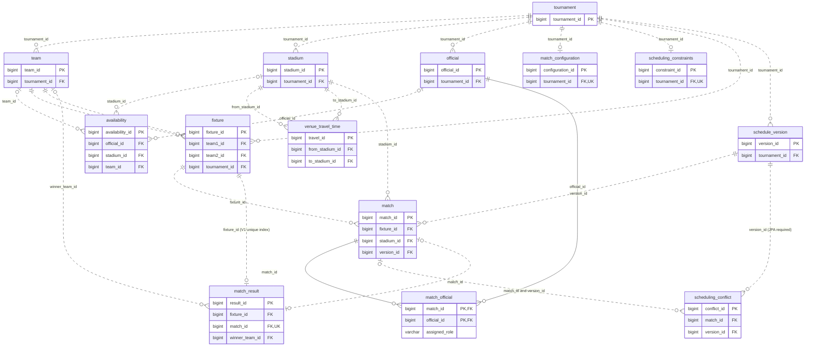

# CRICCRAFT_ER_DIAGRAM_DATA

## Verification and configuration

- The backend contains **14 `@Entity` classes**, one `@Embeddable` and zero `@MappedSuperclass` classes. All are under `Backend/src/main/java/com/example/backend/e2/entity/`. `MatchOfficialId` supplies the composite key of `match_official`.
- The live PostgreSQL catalog for `cricket_tournament_db` is **unverified**. The tables, columns, constraints and relationships below come from the source model and checked-in SQL.
- `Backend/src/main/resources/application.properties` sets `spring.jpa.hibernate.ddl-auto=validate`. With both naming strategies unspecified in the file, Spring Boot 4.1.2 uses `SpringImplicitNamingStrategy` and Hibernate's `PhysicalNamingStrategySnakeCaseImpl`. Table and column names are explicit in these mappings, including the quoted table `"match"`.
- SQL types and sizes come from Hibernate 7.4.13.Final's PostgreSQL-dialect DDL generated offline from the current annotations. `time(0)` and `timestamp(6)` are without time zone. `varchar(255)` and `numeric(38,2)` are generated defaults where the entity leaves length or precision unspecified.

## Tables and attributes

`PK` = primary key. `FK` = foreign key mapping. `UQ` = single-column uniqueness declared in JPA. Each FK shown is **unverified against live PostgreSQL**. Composite keys and the migration index are described below.

### `tournament` · `Tournament`

| Column | PostgreSQL model type | Nullable | Key / reference |
| --- | --- | --- | --- |
| `tournament_id` | `bigint` | No | PK (identity) |
| `ball_type` | `varchar(255)` | Yes | — |
| `category` | `varchar(255)` | Yes | — |
| `edition` | `varchar(255)` | Yes | — |
| `end_date` | `date` | Yes | — |
| `host_institution` | `varchar(255)` | Yes | — |
| `name` | `varchar(255)` | No | — |
| `season` | `varchar(255)` | Yes | — |
| `start_date` | `date` | Yes | — |
| `status` | `varchar(255)` | Yes | — |

### `team` · `Team`

| Column | PostgreSQL model type | Nullable | Key / reference |
| --- | --- | --- | --- |
| `team_id` | `bigint` | No | PK (identity) |
| `tournament_id` | `bigint` | No | FK → `tournament.tournament_id` |
| `captain` | `varchar(255)` | Yes | — |
| `coach` | `varchar(255)` | Yes | — |
| `college` | `varchar(255)` | Yes | — |
| `department` | `varchar(255)` | Yes | — |
| `pool` | `varchar(255)` | Yes | — |
| `squad_size` | `integer` | Yes | — |
| `status` | `varchar(255)` | Yes | — |
| `team_name` | `varchar(255)` | No | — |

### `stadium` · `Stadium`

| Column | PostgreSQL model type | Nullable | Key / reference |
| --- | --- | --- | --- |
| `stadium_id` | `bigint` | No | PK (identity) |
| `tournament_id` | `bigint` | No | FK → `tournament.tournament_id` |
| `availability_status` | `varchar(255)` | Yes | — |
| `capacity` | `integer` | Yes | — |
| `curator` | `varchar(255)` | Yes | — |
| `floodlights` | `boolean` | Yes | — |
| `ground_type` | `varchar(255)` | Yes | — |
| `name` | `varchar(255)` | No | — |
| `number_of_pitches` | `integer` | Yes | — |
| `short_name` | `varchar(255)` | Yes | — |

### `official` · `Official`

| Column | PostgreSQL model type | Nullable | Key / reference |
| --- | --- | --- | --- |
| `official_id` | `bigint` | No | PK (identity) |
| `tournament_id` | `bigint` | No | FK → `tournament.tournament_id` |
| `name` | `varchar(255)` | No | — |
| `qualification` | `varchar(255)` | Yes | — |
| `role` | `varchar(255)` | Yes | — |
| `status` | `varchar(255)` | Yes | — |

### `match_configuration` · `MatchConfiguration`

| Column | PostgreSQL model type | Nullable | Key / reference |
| --- | --- | --- | --- |
| `configuration_id` | `bigint` | No | PK (identity) |
| `tournament_id` | `bigint` | No | UQ FK → `tournament.tournament_id` |
| `innings_break_minutes` | `integer` | No | — |
| `match_duration_minutes` | `integer` | No | — |
| `match_format` | `varchar(255)` | No | — |
| `max_bowler_overs` | `integer` | No | — |
| `min_overs_for_dls` | `integer` | Yes | — |
| `overs_per_innings` | `integer` | No | — |
| `points_for_loss` | `numeric(38,2)` | No | — |
| `points_for_tie` | `numeric(38,2)` | No | — |
| `points_for_win` | `numeric(38,2)` | No | — |
| `powerplay_overs` | `integer` | Yes | — |
| `super_over_enabled` | `boolean` | No | — |

### `scheduling_constraints` · `SchedulingConstraints`

| Column | PostgreSQL model type | Nullable | Key / reference |
| --- | --- | --- | --- |
| `constraint_id` | `bigint` | No | PK (identity) |
| `tournament_id` | `bigint` | No | UQ FK → `tournament.tournament_id` |
| `avoid_ground_blackouts` | `boolean` | No | — |
| `avoid_official_blackouts` | `boolean` | No | — |
| `max_matches_per_stadium_per_day` | `integer` | No | — |
| `max_matches_per_team_per_day` | `integer` | No | — |
| `minimum_recovery_minutes` | `integer` | No | — |
| `minimum_travel_minutes` | `integer` | No | — |
| `night_to_morning_restriction` | `boolean` | No | — |
| `reserve_day_enforced` | `boolean` | No | — |
| `travel_buffer_hours` | `numeric(38,2)` | No | — |
| `travel_constraint_enabled` | `boolean` | No | — |

### `availability` · `Availability`

| Column | PostgreSQL model type | Nullable | Key / reference |
| --- | --- | --- | --- |
| `availability_id` | `bigint` | No | PK (identity) |
| `official_id` | `bigint` | Yes | FK → `official.official_id` |
| `stadium_id` | `bigint` | Yes | FK → `stadium.stadium_id` |
| `team_id` | `bigint` | Yes | FK → `team.team_id` |
| `availability_status` | `varchar(255)` | No | — |
| `available_date` | `date` | No | — |
| `end_time` | `time(0)` | No | — |
| `start_time` | `time(0)` | No | — |

### `venue_travel_time` · `VenueTravelTime`

| Column | PostgreSQL model type | Nullable | Key / reference |
| --- | --- | --- | --- |
| `travel_id` | `bigint` | No | PK (identity) |
| `from_stadium_id` | `bigint` | No | FK → `stadium.stadium_id` |
| `to_stadium_id` | `bigint` | No | FK → `stadium.stadium_id` |
| `travel_minutes` | `integer` | No | — |

### `fixture` · `Fixture`

| Column | PostgreSQL model type | Nullable | Key / reference |
| --- | --- | --- | --- |
| `fixture_id` | `bigint` | No | PK (identity) |
| `team1_id` | `bigint` | No | FK → `team.team_id` |
| `team2_id` | `bigint` | No | FK → `team.team_id` |
| `tournament_id` | `bigint` | No | FK → `tournament.tournament_id` |
| `match_number` | `integer` | No | — |
| `round_number` | `integer` | No | — |
| `status` | `varchar(255)` | No | — |

### `schedule_version` · `ScheduleVersion`

| Column | PostgreSQL model type | Nullable | Key / reference |
| --- | --- | --- | --- |
| `version_id` | `bigint` | No | PK (identity) |
| `tournament_id` | `bigint` | No | FK → `tournament.tournament_id` |
| `created_at` | `timestamp(6)` | No | — |
| `match_count` | `integer` | No | — |
| `version_name` | `varchar(255)` | No | — |

### `"match"` · `Match`

| Column | PostgreSQL model type | Nullable | Key / reference |
| --- | --- | --- | --- |
| `match_id` | `bigint` | No | PK (identity) |
| `fixture_id` | `bigint` | No | FK → `fixture.fixture_id` |
| `stadium_id` | `bigint` | No | FK → `stadium.stadium_id` |
| `version_id` | `bigint` | No | FK → `schedule_version.version_id` |
| `end_time` | `timestamp(6)` | No | — |
| `match_status` | `varchar(255)` | No | — |
| `pitch_number` | `integer` | Yes | — |
| `start_time` | `timestamp(6)` | No | — |

### `match_official` · `MatchOfficial`

| Column | PostgreSQL model type | Nullable | Key / reference |
| --- | --- | --- | --- |
| `match_id` | `bigint` | No | PK FK → `"match".match_id` |
| `official_id` | `bigint` | No | PK FK → `official.official_id` |
| `assigned_role` | `varchar(255)` | No | — |

### `scheduling_conflict` · `SchedulingConflict`

| Column | PostgreSQL model type | Nullable | Key / reference |
| --- | --- | --- | --- |
| `conflict_id` | `bigint` | No | PK (identity) |
| `match_id` | `bigint` | Yes | FK part → `"match".match_id` with `version_id` |
| `version_id` | `bigint` | JPA no / generated DDL yes | FK part → `"match".version_id` with `match_id` FK → `schedule_version.version_id` |
| `conflict_code` | `varchar(255)` | No | — |
| `message` | `text` | No | — |
| `resolved` | `boolean` | No | — |
| `severity` | `varchar(255)` | No | — |
| `suggestion` | `text` | Yes | — |

### `match_result` · `MatchResult`

| Column | PostgreSQL model type | Nullable | Key / reference |
| --- | --- | --- | --- |
| `result_id` | `bigint` | No | PK (identity) |
| `fixture_id` | `bigint` | No | FK → `fixture.fixture_id` |
| `match_id` | `bigint` | Yes | UQ FK → `"match".match_id` |
| `winner_team_id` | `bigint` | Yes | FK → `team.team_id` |
| `remarks` | `varchar(1000)` | Yes | — |
| `result_type` | `varchar(255)` | No | — |
| `team1_overs` | `numeric(38,2)` | No | — |
| `team1_score` | `integer` | No | — |
| `team1_wickets` | `integer` | Yes | — |
| `team2_overs` | `numeric(38,2)` | No | — |
| `team2_score` | `integer` | No | — |
| `team2_wickets` | `integer` | Yes | — |
| `winning_margin` | `integer` | Yes | — |

## Cardinalities and constraints

- **Tournament setup (1:N and optional 1:1).** A tournament can have zero or many teams, stadiums, officials, fixtures and schedule versions. Each of those rows belongs to one tournament in JPA. `match_configuration.tournament_id` and `scheduling_constraints.tournament_id` are required and unique, so each tournament can have zero or one row of each. JPA names those constraints `uq_match_configuration_tournament` and `uq_scheduling_constraints_tournament`.
- **Fixtures and schedule versions (1:N).** A fixture has two required team references, one per role. Each scheduled `"match"` references one fixture, one schedule version and one stadium. A fixture can have multiple scheduled matches across versions. `SchedulePersistenceService` validates that a fixture occurs at most once in a saved version. The source mapping does not declare a unique key on `(fixture_id, version_id)`.
- **Match officials (M:N).** `match_official` has composite PK `(match_id, official_id)` and two identifying FKs. Each assignment references one match and one official and stores `assigned_role`. The key permits at most one assignment per match and official pair. The schedule save flow requires three distinct officials per match.
- **Availability (optional 1:N per owner type).** A team, stadium or official can have zero or many availability windows. Each of the three owner columns is independently nullable in JPA. `SchedulingConfigurationService` assigns exactly one owner to each new row, constrains the date to the tournament date range and checks that the end is after the start. An exactly-one-owner SQL check is unverified.
- **Venue travel (directed M:N).** `uq_venue_travel_pair` constrains the ordered pair `(from_stadium_id, to_stadium_id)`. A stadium can have zero or many outgoing and incoming travel rows. The service looks up both stadiums within the tournament and requires different IDs.
- **Scheduling conflicts (1:N).** `scheduling_conflict.version_id` points to `schedule_version.version_id`. The optional read-only match association uses the composite FK `(match_id, version_id) → "match"(match_id, version_id)`. A conflict can apply at version level without a match. Hibernate's offline DDL supplies `UNIQUE (match_id, version_id)` on `"match"` for that composite reference. The required `scheduleVersion` association shares `version_id` with the optional `match` association, and the offline DDL makes the shared column nullable. Live nullability is unverified.
- **Match results (optional 1:1 and 1:N).** JPA declares `uq_match_result_match` on the nullable `match_id`, so each scheduled match can be referenced by zero or one result. A team can be the optional winner on zero or many results. The service finds and saves a result by fixture and associates it with the latest scheduled match for that fixture, ordered by the schedule version's creation time.

### Fixture-scoped results and schema differences

The checked-in `Backend/src/main/resources/db/migration/V1__fixture_scoped_match_results.sql` adds `match_result.fixture_id`, backfills it from `"match".fixture_id`, adds FK `fk_match_result_fixture` and creates the partial unique index `uq_match_result_fixture` on `fixture_id WHERE fixture_id IS NOT NULL`. It adds `team1_wickets`, `team2_wickets`, `winning_margin` and `remarks`, and drops `NOT NULL` from `match_id`.

- JPA alone models fixture to result as 1:N, with a required fixture per result. The migration allows zero or one fixture per result and zero or one result per fixture through its nullable FK and partial unique index. The service saves one result per fixture. Migration application and live enforcement are unverified.
- `FixtureRepository` uses a PostgreSQL `ON CONFLICT` target on `(tournament_id, round_number, LEAST(team1_id, team2_id), GREATEST(team1_id, team2_id))`, which requires a matching unique index or constraint. The repository expects uniqueness per tournament, round and unordered team pair. The index is absent from the JPA mapping and unverified in PostgreSQL.
- The save service accepts version names of 1 to 100 characters, checks for duplicates within a tournament and expects database uniqueness on `(tournament_id, version_name)`. That compound constraint is outside the JPA mapping. Live enforcement is unverified.
- Exact SQL defaults, FK constraint names and update/delete actions, check constraints, additional indexes and physical drift require catalog evidence.

### Java field defaults

| Entity | Initial values |
| --- | --- |
| `MatchConfiguration` | `innings_break_minutes = 15`, `points_for_win = 2`, `points_for_tie = 1`, `points_for_loss = 0`, `super_over_enabled = true` |
| `SchedulingConstraints` | `minimum_recovery_minutes = 720`, `max_matches_per_team_per_day = 1`, `max_matches_per_stadium_per_day = 3`, `minimum_travel_minutes = 60`, `travel_buffer_hours = 1`, `travel_constraint_enabled = true`, `avoid_ground_blackouts = true`, `avoid_official_blackouts = true`, `night_to_morning_restriction = true`, `reserve_day_enforced = false` |
| `SchedulingConflict` | `resolved = false` |

## Java enums and stored codes

| Java enum | Values | Use |
| --- | --- | --- |
| `SchedulingAvailabilityRequest.Status` | `AVAILABLE`, `UNAVAILABLE` | The availability API stores the enum name as a string in `availability.availability_status`. |
| `SchedulingResult.Status` | `FIXTURES_GENERATED` | Fixture generation response DTO. |
| `CompleteSchedulingResult.Status` | `SCHEDULE_GENERATED`, `INVALID_INPUT`, `NO_FEASIBLE_SCHEDULE`, `SEARCH_LIMIT_REACHED` | Complete scheduling response DTO. |

The entities use strings for statuses, result types, formats, assigned roles and conflict codes. `MatchResultService` accepts `COMPLETED`, `TIED`, `ABANDONED` and `NO_RESULT` for `result_type`. The schedule save path initializes new fixtures with `PENDING` and matches with `SCHEDULED`. PostgreSQL enum types and check constraints are unverified.

## Mermaid ER diagram

This diagram shows the intended source model. Every edge is unverified against live PostgreSQL. `fixture` → `match_result` combines the required JPA join with the one-result limit in the checked-in migration. The schedule-version-to-conflict edge follows the required JPA association. The composite conflict-to-match link uses both `match_id` and `version_id`.

